# ToDo · Lab 7 — Seguridad con Spring Security y JWT

**Escuela Colombiana de Ingeniería Julio Garavito** · Desarrollo y Operaciones de Software (DOSW)
**Caso de estudio:** App ToDo · Gestión de tareas
**Base:** [Laboratorio 6 · ToDo Full Stack](docs/lab6/LAB6.md)

| Repositorio | Contenido |
|---|---|
| [back-end-lab06](https://github.com/Miguelim101/back-end-lab06) | API REST Spring Boot, scripts SQL, diagramas, evidencias y este README general |
| [front-end-lab06](https://github.com/Miguelim101/front-end-lab06) | SPA React + Vite |

Enunciado y reglas del laboratorio: [requirements_part2.md](docs/lab7/requirements_part2.md) · [LAB7.md](docs/lab7/LAB7.md)

---

## Índice

1. [Alcance](#1-alcance)
2. [Estado inicial](#2-estado-inicial)
3. [Planeación (checklist)](#3-planeación-checklist)
4. [Requerimientos e historias de usuario](#4-requerimientos-e-historias-de-usuario)
5. [Diseño](#5-diseño)
6. [Flujo de autenticación JWT](#6-flujo-de-autenticación-jwt)
7. [Contrato de endpoints](#7-contrato-de-endpoints)
8. [Decisiones de seguridad](#8-decisiones-de-seguridad)
9. [Ejecución local](#9-ejecución-local)
10. [Desarrollo paso a paso y evidencias](#10-desarrollo-paso-a-paso-y-evidencias)
11. [Pruebas y cobertura](#11-pruebas-y-cobertura)
12. [Definition of Done](#12-definition-of-done)
13. [Informe y video](#13-informe-y-video)

---

## 1. Alcance

La aplicación ToDo del Lab 6 (React + Spring Boot + PostgreSQL en Docker) se extiende con **cuentas de usuario y tareas privadas**:

- Registro de usuarios e inicio de sesión con contraseñas almacenadas mediante **BCrypt**.
- Emisión de un **JWT firmado (HS256)** con duración de **30 minutos** y validación en cada petición protegida.
- Aislamiento por identidad: **cada usuario solo puede ver, crear, editar y eliminar sus propias tareas** (incluido el calendario semanal).
- Recurso administrativo `GET /api/v1/admin/summary` exclusivo para el rol `ADMIN`.
- Frontend con vistas de registro, inicio de sesión, tareas y cierre de sesión; el token se conserva **en memoria**.
- Pruebas unitarias y de integración para los flujos correctos y los intentos de acceso indebido.

**Fuera de alcance** (según el enunciado): despliegue en la nube, CI/CD, OAuth con Google, refresh tokens, MFA y recuperación de contraseña.

---

## 2. Estado inicial

Al iniciar el Lab 7 la aplicación cuenta con:

- **Back-end:** API REST `/api/v1/tasks` (CRUD completo + filtro `?from&to` para el calendario), capas Controller → Service → Repository → Entity, DTOs, manejo de errores `{status, message}` (400/404), CORS para `http://localhost:5173` y pruebas unitarias (Service y Controller) con JaCoCo ≥ 70 %.
- **Base de datos:** PostgreSQL 17 (`postgres:17-alpine`) en el contenedor `todo-postgres` con volumen persistente; esquema creado por `database/001_create_schema.sql` y `ddl-auto: validate`.
- **Front-end:** React 19 + Vite con `TaskForm`, `TaskList`, `TaskItem`, `TaskCalendar`, el hook `useTasks` y `taskApi.js`; pruebas con Vitest + React Testing Library.
- **Sin seguridad:** cualquier cliente puede consultar y modificar todas las tareas; no existe el concepto de usuario.

**Cambios previstos:** tabla `users` y propietario en `tasks`; Spring Security + OAuth2 Resource Server (JWT); controladores de autenticación, perfil y administración; filtrado por propietario en Service/Repository; vistas de login/registro y sesión en React.

Rama de trabajo: `feature/jwt-security` (en ambos repositorios).

| Evidencia | |
|---|---|
| PostgreSQL en Docker | 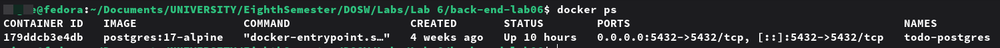 |
| CRUD inicial en React | 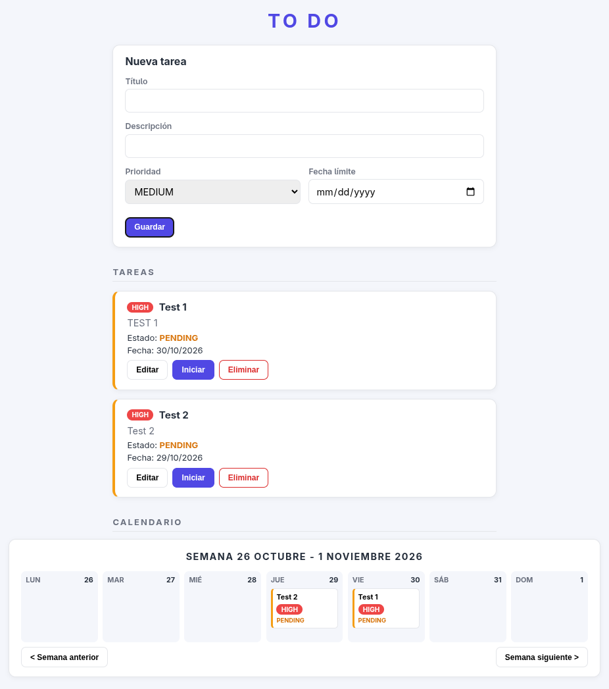 |
| Pruebas back-end iniciales | 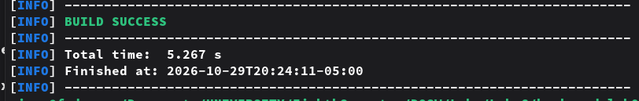 |
| Pruebas front-end iniciales | 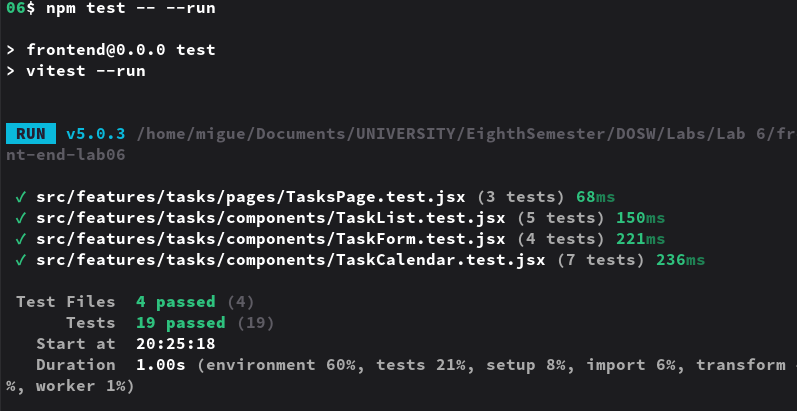 |

---

## 3. Planeación (checklist)

> **Nota:** No implementé Jira dado que la historia de usuario ya estaba creada en el documento y la verdad vi más rápido hacerlo por checklist que crear el Jira (tengo que hacer proyecto, entiéndanme, además que son funcionalidades cortas).

La planeación conserva la misma organización que se habría llevado a Jira (épica → features → historias → tareas). Cada tarea se marca al completarse.

**Épica SEG · Seguridad con Spring Security y JWT**

#### Feature F1 · Gestión de cuentas

**HU-SEG-01 · Registro**
- [x] Script `002_create_users.sql`
- [x] Entidad y repositorio de usuarios
- [x] DTOs `RegisterRequest` / `UserResponse`
- [x] Registro con BCrypt y rol USER
- [x] Manejo de correo duplicado (409)
- [x] `RegisterForm` en React
- [x] Pruebas PT-01, PT-02, PT-03

**HU-SEG-02 · Inicio de sesión**
- [x] Configuración JWT (encoder/decoder)
- [x] `TokenService`
- [x] Login con 401 genérico
- [x] `GET /users/me`
- [x] `AuthContext` + `LoginForm`
- [x] Header `Authorization` en `taskApi.js`
- [x] Pruebas PT-04, PT-05

#### Feature F2 · Protección y aislamiento de datos

**HU-SEG-04 · Protección de recursos**
- [ ] Exigir JWT en `/tasks/**`
- [ ] Respuesta 401 en JSON
- [ ] Adaptar `TaskControllerTest`
- [ ] Pruebas PT-06, PT-08, PT-09

**HU-SEG-03 · Acceso a las tareas propias**
- [ ] Script `003_add_task_owner.sql` (migración de tareas previas)
- [ ] Relación `TaskEntity` → `UserEntity`
- [ ] Consultas por propietario en Repository/Service
- [ ] Usuario tomado del JWT en el Controller
- [ ] Calendario filtrado por propietario
- [ ] Pruebas de repositorio e integración PT-07, PT-10..PT-13, PT-18

#### Feature F3 · Autorización por roles

**HU-SEG-05 · Recurso administrativo**
- [ ] `GET /admin/summary`
- [ ] Regla `hasRole('ADMIN')`
- [ ] Respuesta 403 en JSON
- [ ] Procedimiento de ADMIN local
- [ ] Pruebas PT-14, PT-15

#### Feature F4 · Sesión en el frontend

**HU-SEG-06 · Sesión en React**
- [ ] Barra con usuario y "Cerrar sesión"
- [ ] Limpieza de estado al cerrar sesión
- [ ] Redirección al login ante 401
- [ ] Pruebas PT-16, PT-17

#### Feature F5 · Diseño y documentación
- [ ] Diagramas C4 (contexto, contenedores, componentes)
- [ ] Diagrama de clases
- [ ] Modelo ER
- [ ] README
- [ ] Informe `docs/informe-seguridad-jwt.md`

---

## 4. Requerimientos e historias de usuario

### 4.1 Requerimientos funcionales

| Código | Requerimiento | Resultado esperado | Estado |
|---|---|---|---|
| RF-SEG-01 | Registrar usuario | Crear cuenta con nombre, correo y contraseña. | ✅ HU-SEG-01 |
| RF-SEG-02 | Autenticar usuario | Validar credenciales y emitir JWT firmado. | ✅ HU-SEG-02 |
| RF-SEG-03 | Mantener sesión en React | Utilizar el token en las peticiones a los recursos protegidos. | ✅ HU-SEG-02 |
| RF-SEG-04 | Consultar perfil | Obtener los datos no sensibles del usuario autenticado. | ✅ HU-SEG-02 |
| RF-SEG-05 | Proteger el CRUD | Requerir token válido en los recursos de tareas. | ⬜ |
| RF-SEG-06 | Aislar tareas por usuario | Listar, consultar, crear, editar y eliminar solo tareas propias. | ⬜ |
| RF-SEG-07 | Gestionar autorización por roles | Reservar un endpoint administrativo exclusivamente al rol `ADMIN`. | ⬜ |
| RF-SEG-08 | Cerrar sesión en frontend | Limpiar el estado de autenticación y volver al inicio de sesión. | ⬜ |
| RF-SEG-09 | Manejar errores de seguridad | Diferenciar errores de validación, autenticación, autorización y recursos inexistentes. | ⬜ |
| RF-SEG-10 | Validar seguridad mediante pruebas | Cubrir rutas públicas, protegidas, token inválido y acceso cruzado. | ⬜ |

Las reglas funcionales y de seguridad (2.1) están en [requirements_part2.md](docs/lab7/requirements_part2.md#21-reglas-funcionales-y-de-seguridad).

### 4.2 Historias de usuario

| HU | Historia | Criterios de aceptación | Estado |
|---|---|---|---|
| HU-SEG-01 | **Como** visitante, **quiero** crear una cuenta con mis datos y una contraseña, **para** usar la aplicación de manera personal. | Registro exitoso con rol USER, contraseña con hash y respuesta sin contraseña ni hash. Correo duplicado: `409 Conflict` sin crear un segundo usuario. | ✅ |
| HU-SEG-02 | **Como** usuario registrado, **quiero** iniciar sesión con correo y contraseña, **para** acceder a mis tareas. | Credenciales válidas: `200 OK` y JWT firmado con expiración. Contraseña incorrecta: `401 Unauthorized`, sin token. | ✅ |
| HU-SEG-03 | **Como** usuario autenticado, **quiero** ver y modificar únicamente mis tareas, **para** mantener privada mi información. | `GET /tasks` devuelve solo las tareas propias. Operar sobre una tarea ajena: `404 Not Found` y la tarea queda sin cambios. | ⬜ |
| HU-SEG-04 | **Como** responsable del sistema, **quiero** que las APIs de tareas exijan un JWT válido, **para** impedir operaciones anónimas o falsificadas. | Sin `Authorization`: `401`. Token alterado o expirado: `401`. | ⬜ |
| HU-SEG-05 | **Como** administrador, **quiero** consultar un resumen general no sensible, **para** conocer la utilización del sistema. | Rol ADMIN: `200 OK` con métricas agregadas. Rol USER: `403 Forbidden`. | ⬜ |
| HU-SEG-06 | **Como** usuario autenticado, **quiero** acceder a mis tareas mientras dure la sesión y cerrarla al terminar, **para** controlar el uso de mi cuenta. | "Cerrar sesión" elimina el token del estado, oculta las tareas y muestra el inicio de sesión. | ⬜ |

Los escenarios Gherkin completos están en [requirements_part2.md](docs/lab7/requirements_part2.md#3-historias-de-usuario).

---

## 5. Diseño

Las fuentes de los diagramas están en [`docs/diagrams/`](docs/diagrams) (PlantUML; los C4 usan la librería estándar C4-PlantUML). En verde aparece lo **nuevo** del Lab 7 y en amarillo lo **modificado**.

Los `.svg` se regeneran con [PlantUML](https://plantuml.com/) (sin Graphviz, usando el motor Smetana): `java -jar plantuml.jar -tsvg -charset UTF-8 -Playout=smetana docs/diagrams/*.puml`

### 5.1 C4 · Nivel 1 · Contexto

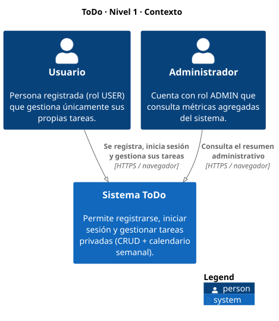

### 5.2 C4 · Nivel 2 · Contenedores

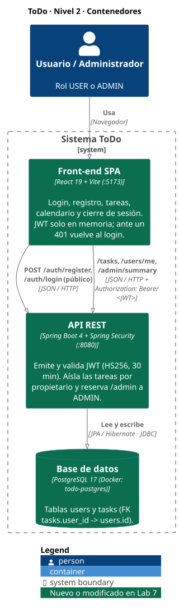

### 5.3 C4 · Nivel 3 · Componentes

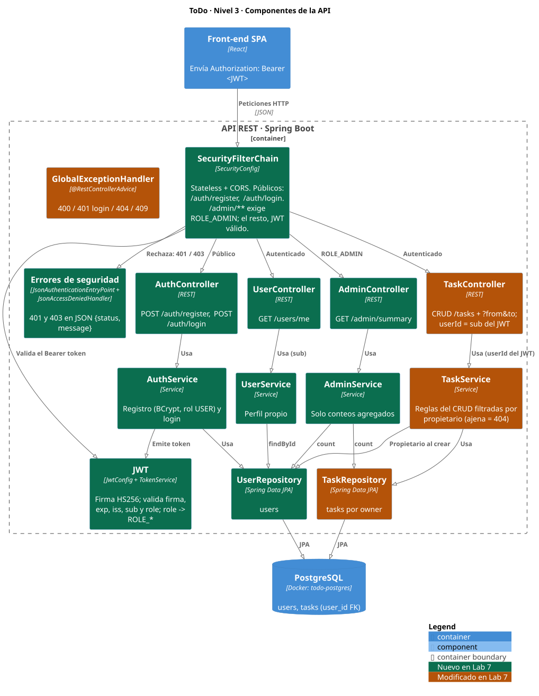

### 5.4 Diagrama de clases

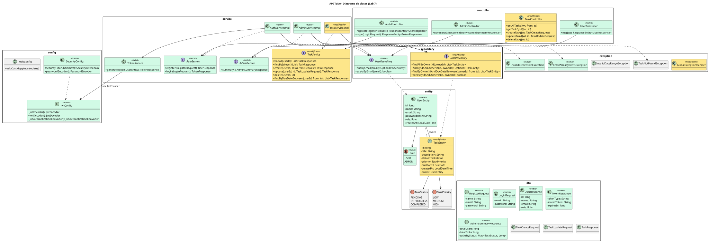

| Responsabilidad (LAB7 §5.2) | Dónde está |
|---|---|
| Usuario / entidad de persistencia | `entity/UserEntity`, `entity/Role` |
| Tarea / entidad de persistencia | `entity/TaskEntity` (relación `owner`) |
| Repositorios | `repository/UserRepository`, `repository/TaskRepository` |
| Registro y autenticación | `service/AuthService`, `service/AuthServiceImpl` |
| Emisión y validación de JWT | `service/TokenService` (emisión), `config/JwtConfig` (encoder, decoder, validadores, conversor de roles) |
| Configuración y reglas de Spring Security | `config/SecurityConfig` |
| Controladores REST | `AuthController`, `UserController`, `AdminController`, `TaskController` |
| DTOs | `RegisterRequest`, `LoginRequest`, `UserResponse`, `TokenResponse`, `AdminSummaryResponse`, `TaskCreateRequest`, `TaskUpdateRequest`, `TaskResponse` |
| Manejo centralizado de excepciones | `exception/GlobalExceptionHandler` + entry point / access denied handler de `SecurityConfig` |

### 5.5 Modelo entidad-relación

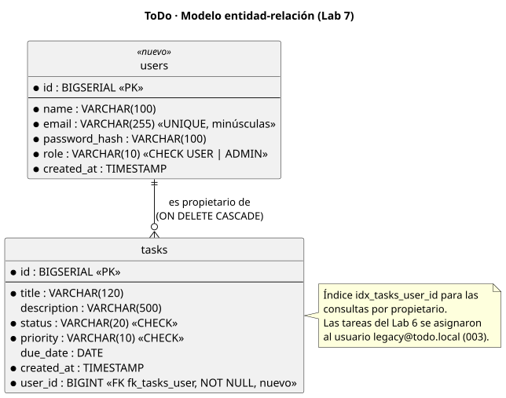

Migraciones en [`database/`](database):

| Script | Contenido |
|---|---|
| `001_create_schema.sql` | Tabla `tasks` (Lab 6) |
| `002_create_users.sql` | Tabla `users` (HU-SEG-01) |
| `003_add_task_owner.sql` | `tasks.user_id` + migración de tareas previas (HU-SEG-03) |

---

## 6. Flujo de autenticación JWT

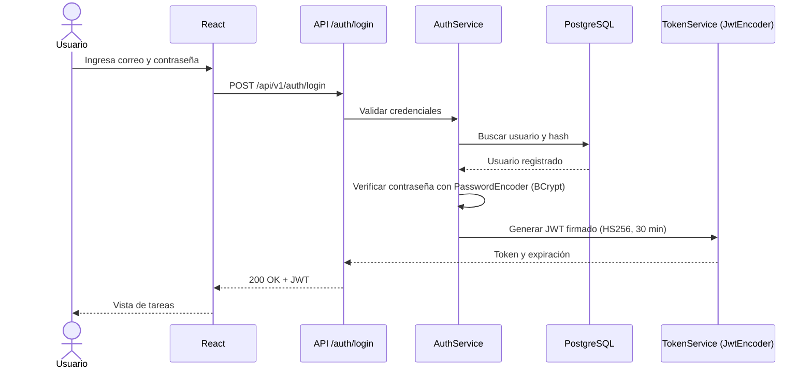

---

## 7. Contrato de endpoints

Base: `http://localhost:8080/api/v1`. Todas las respuestas de error tienen la forma `{"status": <código>, "message": "<detalle>"}`.

### 7.1 Públicos

| Método | Endpoint | Cuerpo | Respuestas | HU |
|---|---|---|---|---|
| `POST` | `/auth/register` | `{"name", "email", "password"}` | `201` `{id, name, email, role}` · `400` datos inválidos · `409` correo ya registrado | HU-SEG-01 |
| `POST` | `/auth/login` | `{"email", "password"}` | `200` `{tokenType, accessToken, expiresIn}` · `400` datos vacíos · `401` credenciales inválidas | HU-SEG-02 |

Ejemplo de registro:

```http
POST /api/v1/auth/register
Content-Type: application/json

{"name": "Ana Pérez", "email": "ana@example.com", "password": "ContrasenaDemo123!"}
```

```json
{"id": 1, "name": "Ana Pérez", "email": "ana@example.com", "role": "USER"}
```

Ejemplo de inicio de sesión:

```http
POST /api/v1/auth/login
Content-Type: application/json

{"email": "ana@example.com", "password": "ContrasenaDemo123!"}
```

```json
{"tokenType": "Bearer", "accessToken": "<JWT_FIRMADO>", "expiresIn": 1800}
```

### 7.2 Autenticados

Requieren la cabecera `Authorization: Bearer <JWT>`. Sin token, o con un token inválido o expirado, responden `401` con `{"status": 401, "message": ...}` y la cabecera `WWW-Authenticate: Bearer`.

| Método | Endpoint | Respuestas | HU |
|---|---|---|---|
| `GET` | `/users/me` | `200` `{id, name, email, role}` del usuario del token · `401` | HU-SEG-02 |

_Las rutas de tareas se protegen en HU-SEG-04._

### 7.3 Administrador

_Se completa en las siguientes historias._

---

## 8. Decisiones de seguridad

| Tema | Decisión | Dónde |
|---|---|---|
| Contraseñas | Solo se guarda el hash **BCrypt** (sal aleatoria por contraseña, factor de costo 10) mediante el bean `PasswordEncoder`. La contraseña ni su hash se devuelven nunca: `UserResponse` solo expone `id`, `name`, `email` y `role`. Longitud entre 8 y 72 caracteres (BCrypt solo procesa 72 bytes). | `SecurityConfig`, `AuthServiceImpl`, `RegisterRequest` |
| Correo único | Se normaliza (`trim` + minúsculas) antes de consultar y guardar. La BD lo refuerza con `UNIQUE` y un `CHECK (email = LOWER(email))`. Si dos registros simultáneos chocan con el `UNIQUE`, también responde `409`. | `AuthServiceImpl`, `002_create_users.sql` |
| Roles | El registro público asigna **siempre** `USER`; un campo `role` enviado en el JSON se ignora. | `AuthServiceImpl` |
| Cadena de seguridad | `SecurityFilterChain` **stateless**, sin `httpBasic` ni `formLogin`, CSRF desactivado (no hay cookies de sesión; la identidad viaja en `Authorization`). Solo `POST /auth/register`, `POST /auth/login` y `/error` son públicos; el resto exige un JWT válido (OAuth2 Resource Server). | `SecurityConfig` |
| Firma del JWT | **HS256** (HMAC-SHA256) con `NimbusJwtEncoder`/`NimbusJwtDecoder`, ambos construidos con la **misma** llave en `JwtConfig`. La firma se verifica en cada petición protegida; decodificar el Base64 no basta para que un token sea aceptado. | `JwtConfig` |
| Contenido del JWT | `sub` (id del usuario), `iss` (`todo-api`), `iat`, `exp`, `role` y `name`. No incluye correo, contraseña ni hash. | `TokenService` |
| Validación del JWT | Firma + `exp`/`nbf` + `iss` (`JwtValidators.createDefaultWithIssuer`) y un validador propio que exige `sub` numérico y `role` ∈ {`USER`, `ADMIN`}. El claim `role` se convierte en la autoridad `ROLE_USER` / `ROLE_ADMIN`. | `JwtConfig` |
| Duración | **30 minutos** (`expiresIn: 1800`). No hay refresh tokens: al vencer, hay que iniciar sesión de nuevo. | `application.yaml` |
| Llave de firma | Variable de entorno `JWT_SECRET` (Base64, mínimo 32 bytes), **sin valor por defecto**: si falta, la aplicación no arranca. Se lee desde el entorno o desde `.env` (excluido de Git). Las pruebas generan una llave aleatoria en cada ejecución. | `application.yaml`, `JwtConfig`, `JwtTestSupport` |
| Login | Mismo `401` y mismo mensaje (`Invalid email or password`) si el correo no existe o la contraseña es incorrecta. Si el correo no existe se compara contra un hash de relleno para que el tiempo de respuesta no revele qué cuentas existen. | `AuthServiceImpl` |
| Errores 401 | Un *entry point* propio responde en JSON con el mismo formato `{status, message}` y conserva `WWW-Authenticate: Bearer`. El mensaje es genérico y el token nunca se registra. | `JsonAuthenticationEntryPoint` |
| Almacenamiento en el front | El JWT vive **solo en memoria** (`api/session.js`), nunca en `localStorage` ni en cookies. Al recargar la página se pierde la sesión y hay que volver a iniciar sesión (decisión del laboratorio). | `session.js`, `AuthContext.jsx` |
| Logs | Se desactiva el usuario en memoria que Spring Boot crea por defecto, porque imprime una contraseña generada en los logs. `show-sql` solo muestra `?` en los parámetros, nunca hashes ni contraseñas. | `application.yaml` |
| CORS | La cadena de seguridad reutiliza la configuración de `WebConfig` (`http://localhost:5173`), así que el *preflight* del navegador funciona sin autenticación. | `SecurityConfig`, `WebConfig` |

> **Estado temporal:** mientras se implementa la protección con JWT (HU-SEG-04), `/api/v1/tasks/**` sigue abierto para no romper el CRUD existente.

---

## 9. Ejecución local

### 9.1 Requisitos

- Docker (contenedor `todo-postgres` con la imagen `postgres:17-alpine` del Lab 6). También lo usan las pruebas de integración (Testcontainers).
- Java 21+ y Maven (o el wrapper `./mvnw`).
- Node.js + npm.

### 9.2 Variables de entorno

Copiar [`.env.example`](.env.example) como `.env` en la raíz de `back-end-lab06/` (está excluido de Git) y completar los valores. Spring Boot lo importa automáticamente.

| Variable | Descripción |
|---|---|
| `DB_URL` | URL JDBC de PostgreSQL (por defecto `jdbc:postgresql://localhost:5432/todo_db`) |
| `DB_USER` / `DB_PASSWORD` | Credenciales de la base de datos |
| `JWT_SECRET` | Llave de firma del JWT, en Base64 y de al menos 32 bytes. Generarla con `openssl rand -base64 32`. **Nunca se sube al repositorio.** |

### 9.3 Pasos

**1. Base de datos.** Con el contenedor `todo-postgres` del Lab 6 encendido (`docker start todo-postgres`), aplicar las migraciones nuevas **en orden**. Cada script se ejecuta una sola vez y ninguno borra datos:

```bash
# Desde back-end-lab06/
docker cp database/002_create_users.sql todo-postgres:/002_create_users.sql
docker exec -i todo-postgres psql -U todo_user -d todo_db -f /002_create_users.sql
```

**2. Variables de entorno.** Crear el `.env` a partir del ejemplo y generar la llave del JWT (una sola vez):

```bash
cd back-end-lab06
cp .env.example .env
# Editar .env y pegar en JWT_SECRET la salida de: openssl rand -base64 32
# (las variables DB_* son opcionales: por defecto apuntan a todo-postgres)
```

**3. Back-end** (puerto `8080`):

```bash
cd back-end-lab06
./mvnw spring-boot:run
```

**4. Front-end** (puerto `5173`):

```bash
cd front-end-lab06
npm install
npm run dev
```

**5. Pruebas:**

```bash
cd back-end-lab06 && ./mvnw clean verify   # Requiere Docker (Testcontainers levanta un PostgreSQL aislado)
cd front-end-lab06 && npm test -- --run
```

---

## 10. Desarrollo paso a paso y evidencias

Todas las capturas están en [`docs/evidence/`](docs/evidence).

### Paso 0 · Punto de partida y planeación (Parte 1)

1. Se verificó que Docker + PostgreSQL + Spring Boot + React funcionaran antes de modificar código (ver [Estado inicial](#2-estado-inicial)).
2. Se creó la rama `feature/jwt-security` en ambos repositorios.
3. Se organizó la épica de seguridad con sus features, historias y tareas en un checklist (ver [Planeación](#3-planeación-checklist)).
4. Se documentaron el estado inicial y el alcance en este README.
5. Se elaboraron los diagramas previstos, marcando los componentes nuevos y modificados (ver [Diseño](#5-diseño)).
6. Ajustes de base: la configuración pasó de `application.properties` a `application.yaml`, se regeneró el Maven wrapper y se agregó `.env.example`.

### HU-SEG-01 · Registro

**Base de datos.** Se creó [`database/002_create_users.sql`](database/002_create_users.sql) con la tabla `users`: `id`, `name`, `email` (`UNIQUE` y en minúsculas), `password_hash`, `role` (`CHECK USER | ADMIN`, por defecto `USER`) y `created_at`. El script corre dentro de una transacción y no toca `tasks`.

| Evidencia | |
|---|---|
| Migración aplicada en `todo-postgres` | 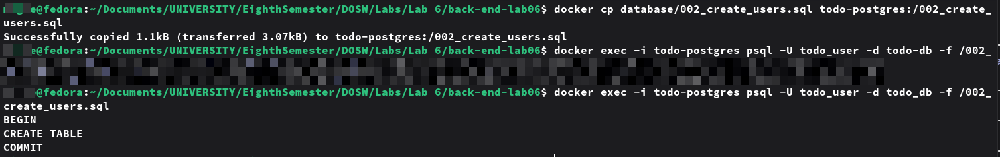 |
| Estructura de la tabla `users` | 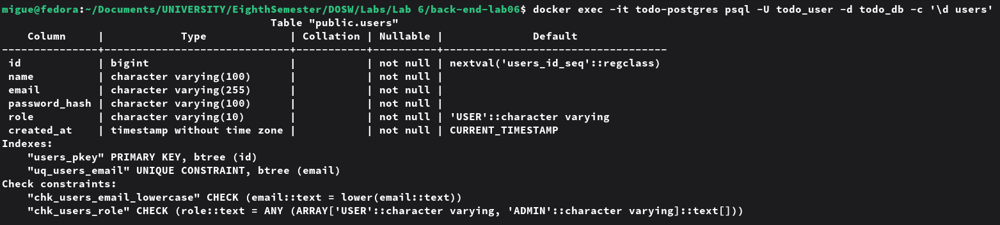 |

**Back-end.**
- `entity/Role` y `entity/UserEntity` mapean la tabla; `repository/UserRepository` agrega `findByEmail` y `existsByEmail`.
- `dto/RegisterRequest` valida nombre (obligatorio, ≤ 100), correo (formato válido) y contraseña (8 a 72 caracteres). `dto/UserResponse` devuelve solo datos no sensibles.
- `service/AuthServiceImpl.register` normaliza el correo, rechaza duplicados con `EmailAlreadyExistsException` (`409`), guarda el hash BCrypt y asigna el rol `USER`.
- `controller/AuthController` expone `POST /api/v1/auth/register` (`201 Created`).
- `config/SecurityConfig` define la cadena stateless y el `PasswordEncoder`; `GlobalExceptionHandler` agrega el `409`.

| Evidencia | |
|---|---|
| Registro válido → `201` sin contraseña | 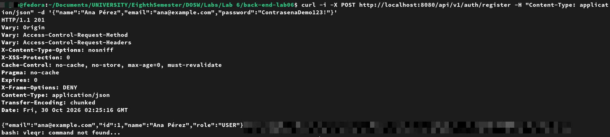 |
| Correo duplicado → `409` | 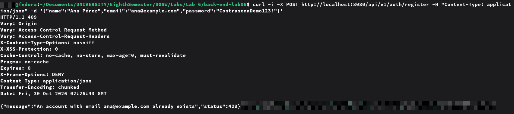 |
| Datos inválidos → `400` | 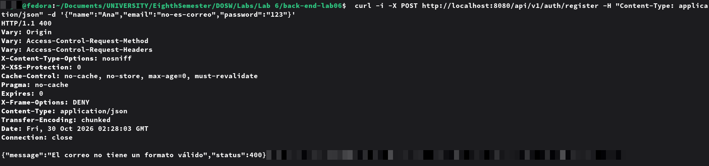 |
| Contraseña guardada como hash BCrypt | 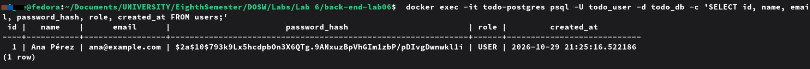 |

**Front-end.** `src/api/authApi.js` consume el registro y `features/auth/components/RegisterForm.jsx` muestra el formulario (nombre, correo, contraseña), valida la longitud mínima y muestra el mensaje del servidor (por ejemplo, correo duplicado). En esta historia se accede desde el botón **Crear cuenta**; en HU-SEG-02 pasa a ser parte de la pantalla de inicio de sesión.

| Evidencia | |
|---|---|
| Registro desde React | 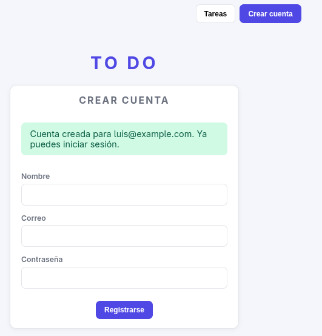 |

**Pruebas.**

| Evidencia | |
|---|---|
| Back-end (`./mvnw clean verify`) | 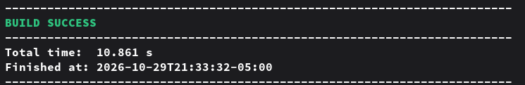 |
| Front-end (`npm test -- --run`) | 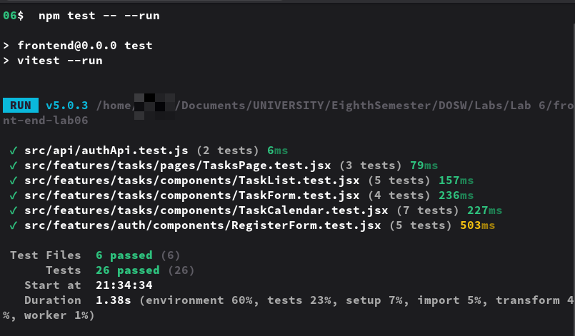 |

### HU-SEG-02 · Inicio de sesión

**Back-end.**
- Se agregó `spring-boot-starter-oauth2-resource-server`. `config/JwtConfig` crea, con la misma llave HS256, el `JwtEncoder` (firma) y el `JwtDecoder` (verificación de firma, `exp`, `iss`, `sub` y `role`), además del conversor del claim `role` a autoridades.
- `service/TokenService` emite el token con `sub`, `iss`, `iat`, `exp` (30 min), `role` y `name`.
- `AuthServiceImpl.login` busca el usuario por correo normalizado, verifica la contraseña con `PasswordEncoder.matches` y, si es válida, emite el token. Si no, lanza `InvalidCredentialsException` (`401`).
- `AuthController` expone `POST /api/v1/auth/login`. `UserController` expone `GET /api/v1/users/me`, que toma la identidad del `sub` del JWT validado y responde con `UserService`.
- `SecurityConfig` activa el Resource Server JWT y `JsonAuthenticationEntryPoint` responde los `401` en JSON.
- La llave se configura con `JWT_SECRET` (ver [Variables de entorno](#92-variables-de-entorno)).

| Evidencia | |
|---|---|
| Login correcto → `200` con JWT (token parcialmente oculto) | 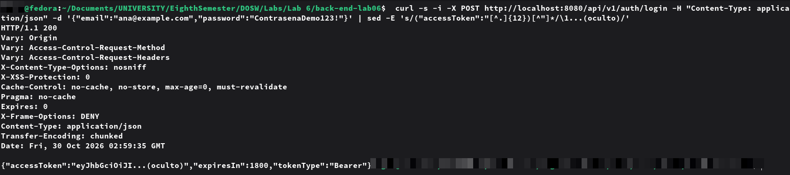 |
| Login incorrecto → `401` sin token | 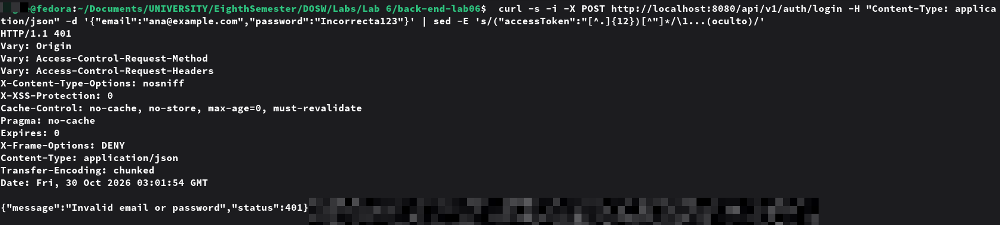 |
| Claims del JWT (`sub`, `iss`, `iat`, `exp`, `role`) | 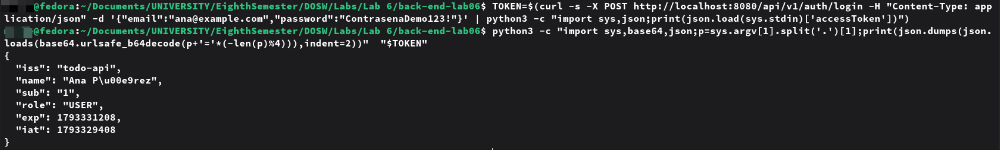 |
| `GET /users/me` con el token → `200` | 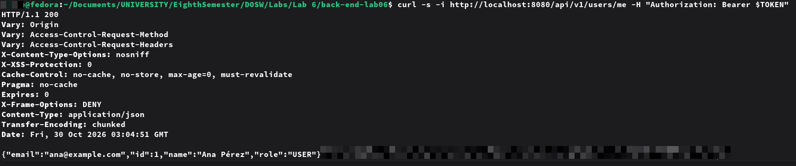 |

**Front-end.**
- `api/session.js` guarda el token **en memoria** y arma la cabecera `Authorization: Bearer <JWT>`, que `taskApi.js` agrega a todas las peticiones de tareas.
- `api/authApi.js` agrega `login` y `me`. `features/auth/context/AuthContext.jsx` (`AuthProvider` + `useAuth`) hace login → guarda el token → consulta el perfil.
- `features/auth/components/LoginForm.jsx` sigue el mockup del laboratorio. `features/auth/pages/AuthPage.jsx` alterna entre inicio de sesión y registro.
- `App.jsx` muestra `AuthPage` sin sesión y `TasksPage` con sesión.

| Evidencia | |
|---|---|
| Pantalla de inicio de sesión | 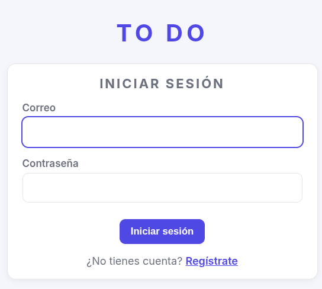 |

**Pruebas.**

| Evidencia | |
|---|---|
| Back-end (`./mvnw clean verify`) | 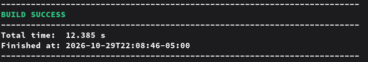 |
| Front-end (`npm test -- --run`) | 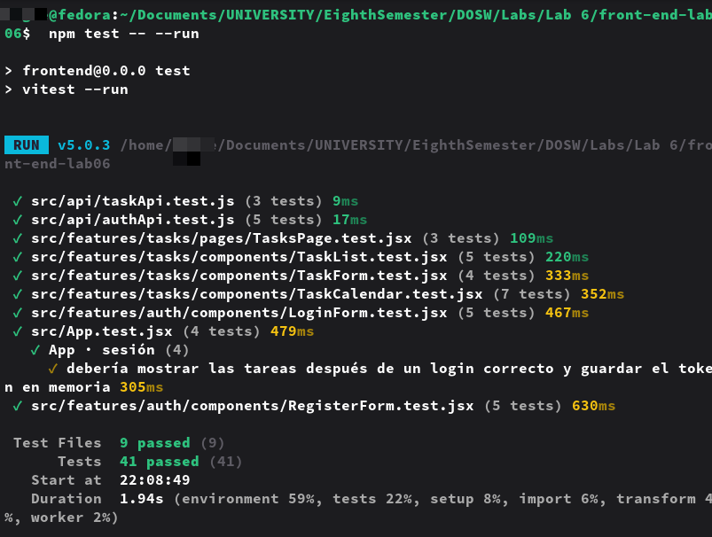 |

---

## 11. Pruebas y cobertura

### 11.1 Tipos de prueba

| Tipo | Herramientas | Clases |
|---|---|---|
| Unitarias de servicio | JUnit 5 + Mockito + AssertJ | `TaskServiceTest`, `AuthServiceTest`, `UserServiceTest`, `TokenServiceTest` (encoder/decoder reales) |
| Controlador (slice web con la cadena de seguridad real) | `@WebMvcTest` + MockMvc + `@Import(SecurityConfig, JwtConfig, ...)` | `TaskControllerTest`, `AuthControllerTest` |
| Integración (aplicación completa + PostgreSQL 17 real en Docker con los scripts de `database/`) | `@SpringBootTest` + MockMvc + Testcontainers | `AuthIntegrationTest` |
| Front-end | Vitest + React Testing Library | `RegisterForm.test.jsx`, `LoginForm.test.jsx`, `App.test.jsx`, `authApi.test.js`, `taskApi.test.js` y las pruebas del Lab 6 |

### 11.2 Matriz de pruebas (PT)

| ID | Prueba | Resultado esperado | Prueba automatizada | Estado |
|---|---|---|---|---|
| PT-01 | Registrar usuario válido | `201`, usuario con rol `USER` | `AuthIntegrationTest.register_shouldCreateUserWithUserRole`, `register_shouldNotAllowChoosingAdminRole`; `AuthServiceTest.register_shouldAssignUserRole`; `AuthControllerTest.register_shouldReturn201WhenRequestIsValid` | ✅ |
| PT-02 | Registrar un correo duplicado | `409`, sin duplicados | `AuthIntegrationTest.register_shouldNotCreateDuplicateEmail`, `register_shouldNotCreateDuplicateWithEquivalentEmail`; `AuthServiceTest.register_shouldNotSaveWhenEmailExists` | ✅ |
| PT-03 | Guardar contraseña | Hash; no texto plano | `AuthIntegrationTest.register_shouldStorePasswordAsBcryptHash`; `AuthServiceTest.register_shouldStoreHashedPassword` | ✅ |
| PT-04 | Login correcto | `200` con token firmado | `AuthIntegrationTest.login_shouldReturnSignedTokenWhenCredentialsAreValid`, `login_shouldAcceptEquivalentEmail`; `AuthServiceTest.login_shouldReturnTokenWhenCredentialsAreValid`; `TokenServiceTest` | ✅ |
| PT-05 | Login incorrecto | `401` sin token | `AuthIntegrationTest.login_shouldReturn401WithoutTokenWhenPasswordIsWrong`, `login_shouldReturn401WhenEmailDoesNotExist`; `AuthServiceTest.login_shouldNotReturnTokenWhenPasswordIsWrong`, `login_shouldNotRevealWhetherEmailExists` | ✅ |
| PT-06 | Consultar tareas sin token | `401` | | ⬜ |
| PT-07 | Consultar tareas con token válido | `200` y solo las propias | | ⬜ |
| PT-08 | Token modificado | `401` | | ⬜ |
| PT-09 | Token expirado | `401` | | ⬜ |
| PT-10 | Consultar tarea ajena | `404`, sin filtración de datos | | ⬜ |
| PT-11 | Modificar tarea ajena | `404`, sin cambios en BD | | ⬜ |
| PT-12 | Eliminar tarea ajena | `404`, sin cambios en BD | | ⬜ |
| PT-13 | Crear tarea autenticada | Se asigna el propietario correcto | | ⬜ |
| PT-14 | Usuario `USER` accede a `/admin/summary` | `403` | | ⬜ |
| PT-15 | Usuario `ADMIN` accede a `/admin/summary` | `200` | | ⬜ |
| PT-16 | Cerrar sesión desde React | Token y tareas dejan de estar disponibles | | ⬜ |
| PT-17 | Respuesta `401` desde una petición React | Redirige a inicio de sesión | | ⬜ |
| PT-18 | Usuario distinto inicia sesión | Solo se muestran sus propias tareas | | ⬜ |

Pruebas adicionales:
- HU-SEG-01: validaciones `400` (correo, contraseña corta, nombre vacío), registro público sin token y *preflight* CORS desde `localhost:5173`.
- HU-SEG-02: `GET /users/me` con token (`200`), sin token y con token inválido (`401` en JSON); token rechazado con otra llave; llave menor a 32 bytes rechazada; el JWT no incluye datos sensibles. En React: el login guarda el token en memoria, `taskApi` envía `Authorization: Bearer` y un login fallido no entra a las tareas.

### 11.3 Resultados

| Corte | Back-end | Front-end | Cobertura JaCoCo (instrucciones / ramas)* |
|---|---|---|---|
| HU-SEG-01 | 44 pruebas, 0 fallos | 26 pruebas, 0 fallos | 100 % / 100 % |
| HU-SEG-02 | 66 pruebas, 0 fallos | 41 pruebas, 0 fallos | 95,2 % / 81,6 % |

\* JaCoCo excluye la clase de arranque, `dto/` y `entity/` (POJOs sin lógica). La regla de `mvn verify` exige como mínimo 70 %. La cobertura no reemplaza las pruebas de los escenarios de seguridad de la matriz.

---

## 12. Definition of Done

- [ ] El CRUD original continúa funcionando para usuarios autenticados.
- [x] Es posible registrarse e iniciar sesión.
- [x] Las contraseñas se almacenan de forma segura.
- [ ] El JWT está firmado, vence y se valida en el servidor.
- [ ] Los endpoints de tareas rechazan peticiones sin autenticación.
- [ ] Ningún usuario puede ver, modificar o eliminar tareas ajenas.
- [ ] El rol `USER` no puede acceder al recurso exclusivo `ADMIN`.
- [ ] React consume recursos protegidos y permite cerrar sesión.
- [ ] Los tests nuevos y los del laboratorio anterior finalizan correctamente.
- [ ] Los diagramas C4, de clases y de datos se encuentran actualizados.
- [ ] Los secretos están fuera del repositorio.
- [ ] Se publicaron el informe y el video de funcionamiento local. _(El video no se realiza en esta entrega.)_

---

## 13. Informe y video

- Informe con las preguntas de comprensión: [`docs/informe-seguridad-jwt.md`](docs/informe-seguridad-jwt.md) _(se publica al cierre)_.